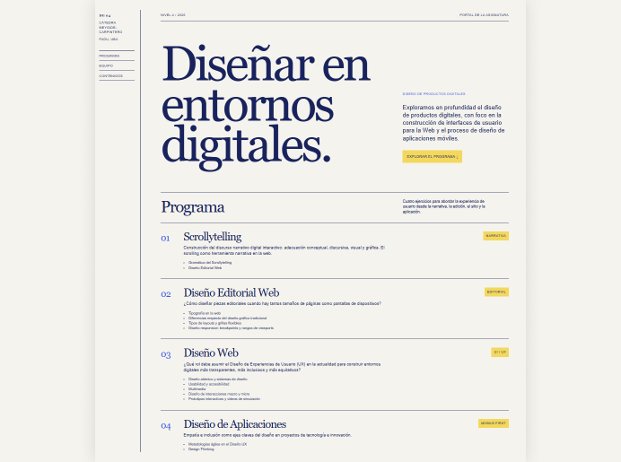

# Diseño Gráfico 4

## Propósito

Este repositorio reúne los contenidos, materiales y recursos de la asignatura Diseño Gráfico 4, Cátedra Meygide-Carpintero, FADU, UBA. Su objetivo es organizar y publicar el programa de la materia, los trabajos prácticos, los instructivos y otros materiales de apoyo para la cursada.

## Contenidos

| Carpeta | Contenido |
| --- | --- |
| `contenidos/` | Archivos Markdown que funcionan como fuente de contenido para las páginas del portal: resumen, programa, equipo docente y trabajos prácticos. |
| `guias/` | Guías, presentaciones, artículos y otros materiales HTML independientes, publicados sin compartir los estilos ni la navegación del portal. |
| `instructivos/` | Instructivos en Markdown y sus recursos asociados, como la guía para crear una cuenta en GitHub y sus imágenes. |
| `portal/` | Proyecto web desarrollado con Vite que transforma parte de los contenidos Markdown en un sitio navegable y visual. Incluye su código fuente, estilos, plantilla, configuración y documentación. |
| `.github/` | Configuración de GitHub Actions para compilar y publicar automáticamente el portal en GitHub Pages. |

## Portal

Aunque muchos materiales se publican como archivos Markdown o como documentos HTML independientes, el repositorio también incluye un portal web para acceder a los contenidos de la asignatura de una manera más amigable, visual y ordenada.

> Para conocer cómo se construye el portal, qué archivos alimentan cada página y cómo instalarlo o ejecutarlo localmente, consultá el [README del portal](portal/README.md).
