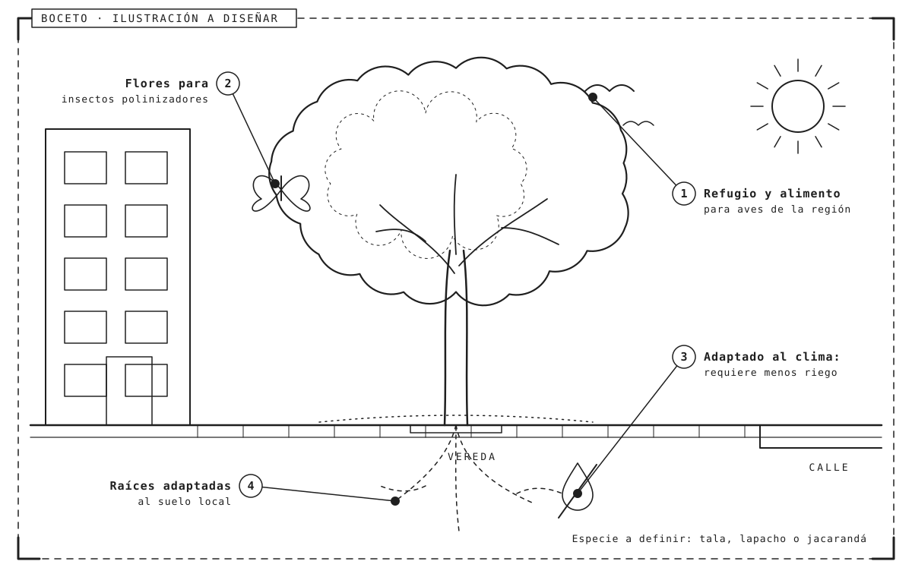
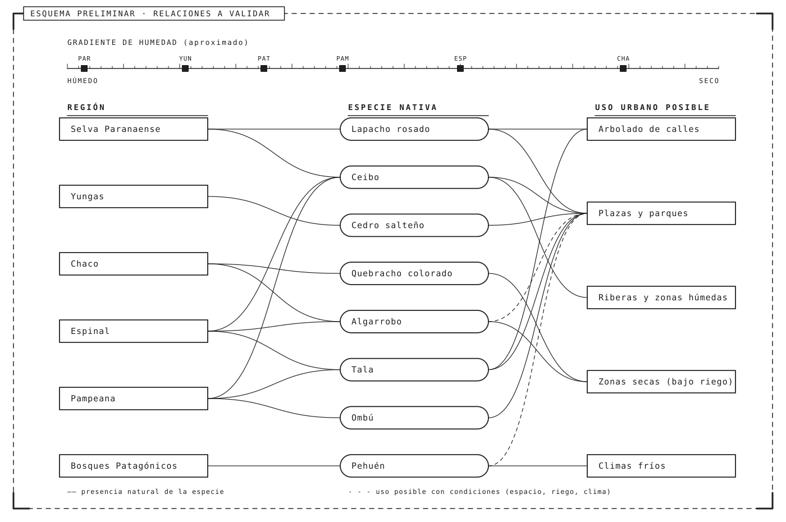
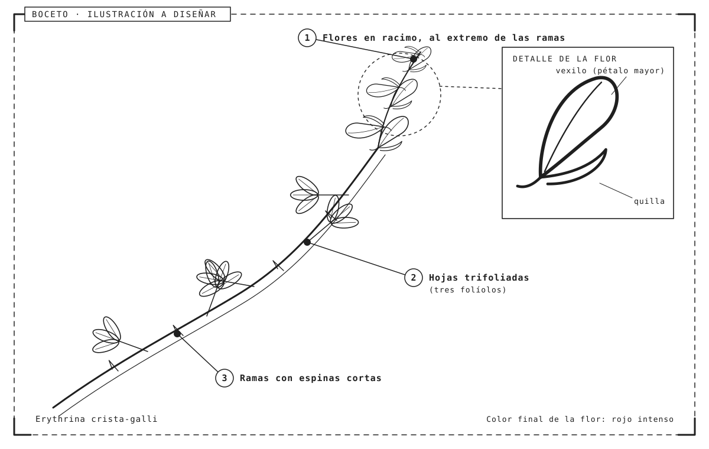

<!--
  ARCHIVO DE EJEMPLO para usar con prompt-sitio-informe.md
  Los comentarios como este no se ven al renderizar el Markdown.
  Indican en qué página del sitio termina cada parte:
    #   → título del sitio (portada)
    ##  → una página: cada "Capítulo" es un capitulo-0N.html; "Referencias" y "Acerca del proyecto" son sus propias páginas
    ### → secciones internas de cada página (índice "En esta página")
  Las imágenes están en la carpeta ejemplo-imagenes/ (junto a este archivo). Son esquicios
  preliminares en línea: indican dónde va cada imagen y qué debería mostrar.
-->

# Árboles nativos de la Argentina

> ¿Qué lugar ocupan los árboles nativos en los paisajes urbanos argentinos y qué los diferencia de las especies exóticas que hoy predominan en calles y plazas?

Este informe reúne los resultados de una breve investigación sobre árboles **autóctonos** de la Argentina: dónde crecen, qué especies se destacan y por qué conviene volver a incorporarlos en el diseño de los espacios públicos.

La investigación combinó la lectura de fuentes especializadas con la observación del arbolado en distintos barrios. El objetivo no fue elaborar un catálogo exhaustivo, sino construir una mirada general que permita reconocer algunas especies representativas y pensar su lugar en la ciudad.

## Capítulo 1 · Introducción

### Qué entendemos por especie nativa

Una especie **nativa** o **autóctona** es la que se originó y evolucionó en una región determinada, sin intervención humana. Se opone a las especies **exóticas**, introducidas desde otras regiones del mundo.

Que una especie sea nativa de la Argentina no significa que sea nativa de *cualquier* lugar del país. Un árbol propio de la selva misionera puede resultar tan ajeno a la Patagonia como una especie traída de otro continente. Por eso, en este informe hablamos de especies nativas **de cada región**.

También conviene distinguir entre especies exóticas y especies **invasoras**: estas últimas, además de haber sido introducidas, se reproducen sin control y desplazan a la flora local. No toda especie exótica es invasora, pero algunas de las más plantadas en las ciudades sí lo son.

### Por qué importan

- Están adaptadas al clima y al suelo de su región, por lo que requieren menos riego y cuidados.
- Sostienen a la fauna local: aves, insectos polinizadores y mariposas.
- Forman parte de la identidad cultural y del paisaje de cada lugar.

*Figura 1. Boceto de ilustración: los beneficios de un árbol nativo en el espacio urbano. La especie concreta se definirá más adelante.*

En el contexto urbano, estas ventajas se traducen en menor mantenimiento y en espacios públicos que funcionan como pequeños corredores biológicos dentro de la ciudad.

## Capítulo 2 · Regiones y paisajes

### Una gran diversidad de ambientes

La Argentina abarca ambientes muy distintos, desde selvas subtropicales hasta bosques fríos de montaña. Cada región tiene su propia flora característica.

| Región | Ambiente | Especie representativa |
|---|---|---|
| Selva Paranaense | Selva subtropical húmeda | Lapacho rosado |
| Yungas | Selva de montaña | Cedro salteño |
| Chaco | Bosque seco | Quebracho colorado |
| Espinal | Bosque bajo y pastizal | Algarrobo |
| Bosques Patagónicos | Bosque frío de montaña | Pehuén (araucaria) |

Las diferencias entre regiones responden sobre todo a la cantidad de lluvia, a la temperatura y al tipo de suelo. A grandes rasgos, la humedad disminuye de noreste a sudoeste, y con ella cambia el tipo de vegetación: de la selva densa al bosque seco, al pastizal y a la estepa.

### Relaciones entre regiones, especies y usos

Para organizar la información relevada, el siguiente esquema vincula cada región con algunas de sus especies representativas y con los posibles usos de esas especies en la ciudad.

*Figura 2. Esquema preliminar: relaciones entre regiones, especies nativas y usos urbanos posibles. Las relaciones deberán validarse con las fuentes.*

### El caso de la región pampeana

En la llanura pampeana predominaba el **pastizal** y los árboles nativos eran escasos, como el **tala** y el **ombú**. Por eso muchas ciudades de la región se arbolaron con especies traídas de otros continentes.

Esta historia explica por qué en ciudades como Buenos Aires el paisaje arbolado que hoy parece "natural" está formado, en gran parte, por especies exóticas. Recuperar especies nativas de la región, o de regiones cercanas con clima similar, es una de las líneas de trabajo del arbolado urbano actual.

## Capítulo 3 · Especies destacadas

### Ceibo

El ceibo (*Erythrina crista-galli*) crece en las riberas y zonas húmedas del litoral. Su flor roja fue declarada **flor nacional** en 1942.

*Figura 3. Boceto de ilustración botánica del ceibo. En la versión final, la flor se representará en color.*

Es un árbol de tamaño mediano, de tronco tortuoso y ramas con pequeñas espinas. Florece desde la primavera hasta el verano, y sus flores atraen a aves como los picaflores. Por su tolerancia a los suelos húmedos, se lo utiliza en plazas, parques y costaneras.

### Lapacho rosado

Árbol del noreste y noroeste del país, muy valorado por su floración rosada de fines del invierno, que ocurre antes de que broten las hojas.

Puede superar los veinte metros de altura en su ambiente natural, aunque en la ciudad suele ser más bajo. Su floración lo convierte en una de las especies nativas más reconocibles y más elegidas para el arbolado ornamental.

### Algarrobo

Árbol de las zonas secas del centro y norte. Sus frutos fueron históricamente un alimento importante para los pueblos originarios.

Su resistencia a la sequía lo vuelve interesante para ciudades con veranos calurosos y poca disponibilidad de agua. Además, su madera y sus frutos tienen un valor cultural que excede lo paisajístico.

> Nota: las imágenes de cada especie se agregarán en la próxima iteración (carpeta `ejemplo-imagenes/`).

## Capítulo 4 · Conclusiones

### Hallazgos principales

1. La mayoría del arbolado urbano relevado corresponde a especies exóticas.
2. Existen especies nativas aptas para el uso urbano en casi todas las regiones.
3. Incorporarlas aporta beneficios ecológicos y de identidad.

Estos hallazgos no implican que deban reemplazarse todos los árboles exóticos existentes. Muchos de ellos forman parte del patrimonio urbano y cumplen funciones importantes, como dar sombra en verano. La propuesta es considerar a las especies nativas como **primera opción** al planificar nuevas plantaciones.

### Preguntas abiertas

- ¿Qué criterios deberían guiar la elección de especies en el diseño de espacios públicos?
- ¿Cómo comunicar el valor de la flora nativa a la comunidad?

Desde el diseño, estas preguntas invitan a pensar piezas de comunicación —señalética, guías, recorridos— que ayuden a reconocer las especies nativas y a valorar su presencia en la ciudad.

## Referencias

- Cabrera, A. L. (1976). *Regiones fitogeográficas argentinas*. Buenos Aires: ACME.
- Instituto de Botánica Darwinion. *Flora del Cono Sur*. [www.darwin.edu.ar](https://www.darwin.edu.ar)

Las fuentes se ampliarán a medida que avance la investigación. Se priorizarán publicaciones académicas y organismos especializados en botánica y arbolado urbano.

## Acerca del proyecto

Investigación realizada en el marco del Trabajo Práctico 4 de **Diseño Gráfico 4** (Cátedra Meygide-Carpintero, FADU-UBA, 2026).

**Equipo:** Nombre Apellido y Nombre Apellido.

El proyecto propone abordar un tema de interés público desde el diseño de la información: organizar, sintetizar y comunicar los resultados de una investigación mediante un sitio web navegable.

<!-- Sin contenido todavía: el sitio debería generar este bloque como "Contenido pendiente" -->
### Metodología
