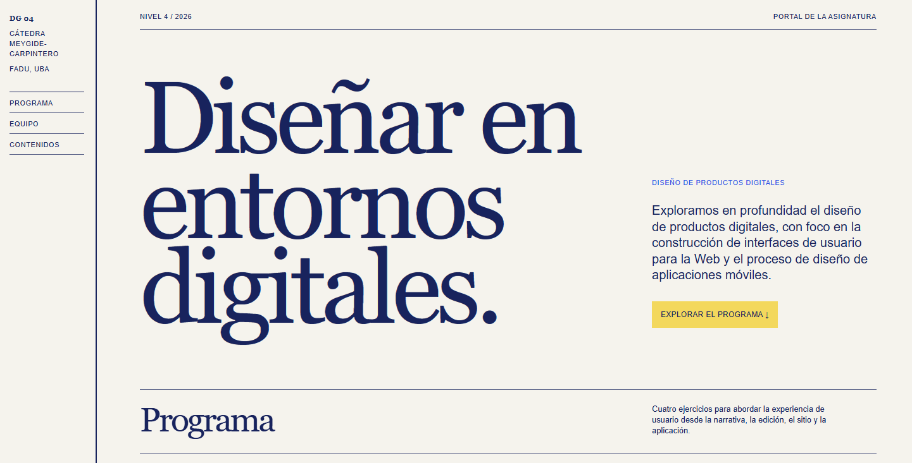
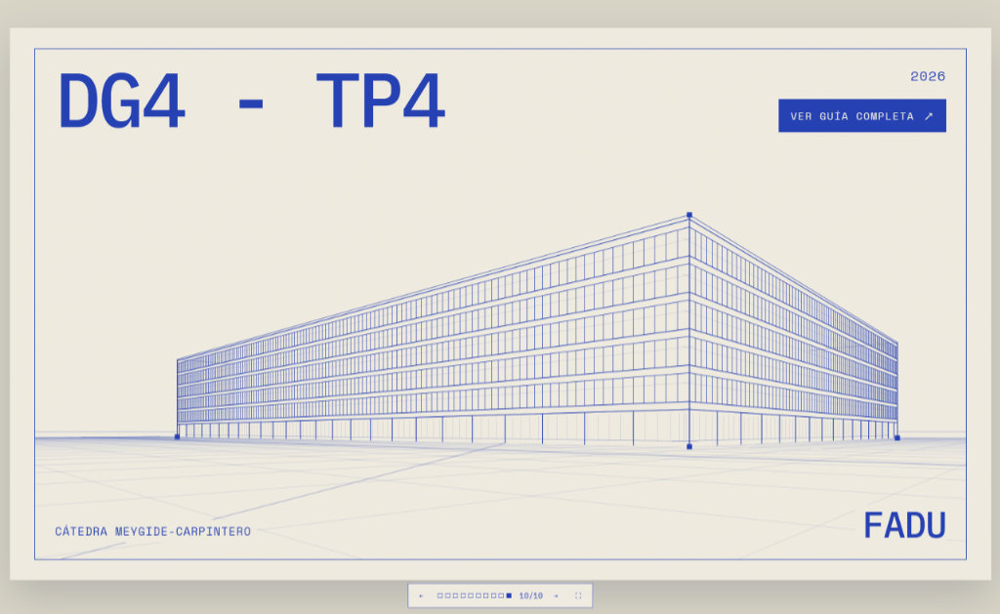

# Portal de Diseño Gráfico 4

Portal web de la asignatura **Diseño Gráfico 4**, Cátedra Meygide-Carpintero, FADU, UBA.

El portal reúne el programa de la materia, los trabajos prácticos, el equipo docente y los instructivos de trabajo. Su contenido se mantiene separado de la estructura y de los estilos del sitio para facilitar su actualización.



## De dónde se obtiene el contenido

La carpeta raíz del repositorio contiene las fuentes de contenido:

```text
contenidos/
├── resumen.md
├── programa.md
├── equipo.md
└── tp-*.md
```

- `contenidos/resumen.md` alimenta los textos de la portada: el texto destacado inicial y el cierre de la home.
- `contenidos/programa.md` alimenta la sección Programa de la home. También define qué trabajos prácticos existen y qué página corresponde a cada uno mediante comentarios como:

  ```md
  <!-- página: tp-investigacion-ia.md -->
  ```

- `contenidos/equipo.md` alimenta la sección Equipo de la home.
- Cada `contenidos/tp-*.md` alimenta su propia página. Las páginas HTML se generan automáticamente a partir de una plantilla; no es necesario crear un HTML nuevo para cada trabajo práctico.
- `instructivos/instructivos.md` define los instructivos que aparecen en la página de contenidos y vincula cada título con su archivo Markdown mediante comentarios como:

  ```md
  ## ¿Cómo crear una cuenta en GitHub?
  <!-- página: guia-crear-cuenta-github.md -->
  ```

  Cada archivo Markdown vinculado alimenta una página HTML generada automáticamente a partir de `portal/instructivo-template.html`. Las imágenes utilizadas por los instructivos se encuentran en `instructivos/medios/`.

## Guías & materiales

Las guías, presentaciones, artículos y otros materiales independientes se mantienen fuera de la estructura visual del portal. Los archivos HTML ubicados en `guias/` se publican directamente, sin compartir los estilos ni la navegación del portal. Por ejemplo, `guias/dg4-26-tp4-guia01.html` queda disponible bajo `/guias/dg4-26-tp4-guia01.html`.

Otros materiales independientes pueden incorporarse en esa carpeta y conservar su propia estructura, estilos y recursos.



## Qué archivos modificar

Para modificar contenidos, editar principalmente los archivos Markdown de la carpeta raíz:

- Portada: `contenidos/resumen.md`.
- Programa y enlaces a los trabajos prácticos: `contenidos/programa.md`.
- Equipo docente: `contenidos/equipo.md`.
- Trabajos prácticos: los archivos `contenidos/tp-*.md` correspondientes.
- Lista de instructivos y sus enlaces: `instructivos/instructivos.md`.
- Contenido de cada instructivo: el archivo Markdown indicado en `instructivos/instructivos.md`.
- Guías HTML independientes: los archivos correspondientes dentro de `guias/`.

Los archivos HTML de `portal/` contienen la estructura de las páginas. La plantilla de los trabajos prácticos es `portal/trabajo-practico-template.html`.

Para modificar la apariencia visual, editar `portal/src/style.css`. Para modificar interacciones —por ejemplo, la navegación móvil— editar `portal/src/main.js`. La configuración de lectura de Markdown, generación de páginas y copia de archivos estáticos se encuentra en `portal/vite.config.js`.

## Tecnologías

- HTML, CSS y JavaScript.
- [Vite](https://vite.dev/) como servidor de desarrollo y herramienta de compilación.
- [Marked](https://marked.js.org/) para convertir Markdown en HTML.
- GitHub Pages para la publicación.
- GitHub Actions para ejecutar automáticamente el build y el deploy.

## Instalación y desarrollo local

Requiere Node.js y npm.

Desde la raíz del repositorio, entrar en la carpeta del portal:

```bash
cd portal
```

Instalar las dependencias:

```bash
npm install
```

Iniciar el servidor de desarrollo:

```bash
npm run dev
```

Vite mostrará en la terminal la dirección local, normalmente `http://localhost:5173/`.

Para generar la versión de producción:

```bash
npm run build
```

El resultado se genera en `portal/dist/`. Para previsualizar ese resultado localmente:

```bash
npm run preview
```

## Publicación

El workflow `.github/workflows/deploy-pages.yml` construye el portal y publica `portal/dist` en GitHub Pages. El deploy se activa al hacer `push` a la rama `main` cuando cambian archivos de `portal/`, `contenidos/`, `instructivos/`, `guias/` o el propio workflow.
